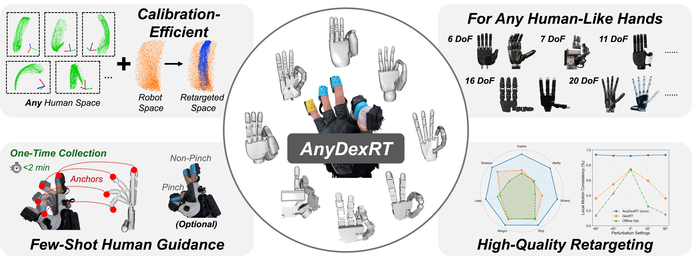
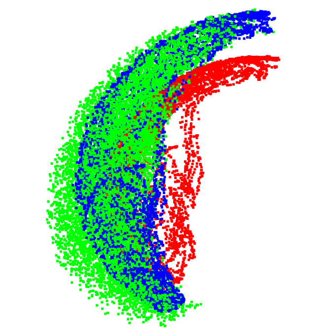
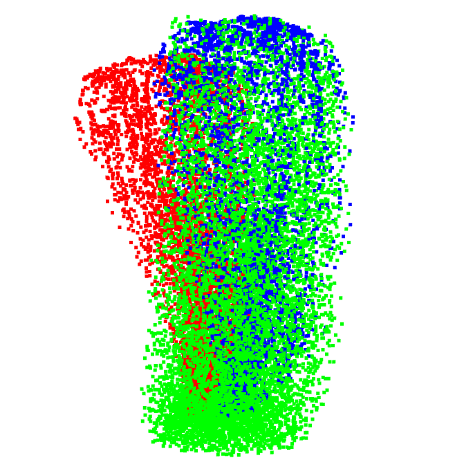

# AnyDexRT: Calibration-Efficient Dexterous Hand Retargeting with Few-Shot Human Guidance

[[paper](https://arxiv.org/abs/2607.08341)] [[project website](https://chenxi-wang.github.io/projects/anydexrt/)]

<p align="center">
  
</p>

Code for AnyDexRT data collection, model training and inference. We provide a pipeline for dexterous hand retargeting using the [MANUS glove](https://www.manus-meta.com/products/overview).


## Setup

1. **Python Dependencies**

    Use Python 3.10+ with CUDA-enabled PyTorch for training. Run all commands from the repository root in your Python environment:

    ```bash
    python -m pip install -r requirements.txt
    ```

2. **MANUS Glove SDK**

    For glove recording and live retargeting, follow [manus_core_python_sdk](https://github.com/chenxi-wang/manus_core_python_sdk) to install and launch the Python interface for MANUS Core 3.1.

3. **Configurations**

    Edit shared settings in `scripts/config.sh`: robot name, data/checkpoint roots, glove serial, inference device, batch size, workers and seed. All workflow scripts source this file. Robot-specific paths are derived from `ROBOT_NAME`, so changing the robot does not require editing every launcher.

    Set `ROBOT_NAME` to a hand configuration in `configs/` and replace `GLOVE_SERIAL` with your own serial before recording. See [New hand registration](#new-hand-registration) for supported hands and custom configurations. The default paths are `data/<robot>/`, `checkpoints/<robot>.pth`, `checkpoints/contact.pth` and `outputs/<robot>/`; shared human recordings live in `data/global_data/`.


## Data collection

Follow the [data collection guide](docs/DATA_COLLECTION.md) for collection commands, recording controls and data formats. Retargeting requires robot samples, glove motion and anchors; contact training also requires contact recordings.


## Model training

Set epochs in each training Bash file; batch size, workers and seed are shared in `scripts/config.sh`.

Train the retargeting model:

```bash
bash scripts/train_retargeting.sh
```

Train the contact classifier for optional contact correction:

```bash
bash scripts/train_contact.sh
```


## Visual results

```bash
bash scripts/visualize_retargeting.sh
```

<p align="center">
  
  &nbsp;&nbsp;
  
</p>

`visualize_retargeting.py` displays three point clouds for each robot finger: red for glove positions, green for robot workspace positions, and blue for model predictions. Close each window to continue to the next finger. `--output-dir` optionally saves the predicted XYZ arrays. Visualization accepts `--device cpu`; CUDA is the default.

```bash
bash scripts/live.sh
```

Live retargeting displays the robot in Open3D without commanding physical hardware. Close the window or interrupt to stop. Contact correction is enabled by default in `scripts/live.sh` and requires both trained checkpoints. Adjust `--contact-threshold` (default `0.5`) to tune confidence weighting. To run without contact correction, remove `--contact-checkpoint` and `--contact-data-dir` from the launcher.


## New hand registration

Currently, we support the following hands: **Ability** (right), **Allegro** (right), **Encos** (right), **Inspire** (right), **LEAP** (right), **Shadow** (right), **Sharpa** (right), **Wuji** (right), **XHand** (right).

To register a new hand, create a JSON configuration using [configs/wuji.json](configs/wuji.json) as a five-finger example or [configs/allegro.json](configs/allegro.json) as a four-finger example.

### 1. Add the robot assets

Place the URDF and its meshes under `hands/<name>_hand/`. Use mesh paths relative to the URDF directory instead of ROS `package://` URLs, and use uniform mesh scale.

**The URDF must contain a fingertip link for every finger, and all fingertip link frames must use a consistent local coordinate convention.** In particular, the local axes must have the same meaning relative to each finger. This consistency is required by the **local motion loss**.

If your URDF lacks fingertip links or uses inconsistent fingertip frames, **you must modify the URDF yourself** before collecting robot data or training. Add the missing fingertip links and adjust their frame origins and orientations as needed, then reference those links in `fingertip_link`. AnyDexRT does not create or align these frames automatically.

### 2. Create the configuration

Copy the closest existing configuration to `configs/<name>.json` and update these fields to match your hand:

| Field | Required configuration |
| --- | --- |
| `hand_name` | Use `<name>`, matching the JSON filename and launcher selection. |
| `urdf_path` | Path to the URDF, such as `hands/<name>_hand/hand.urdf`. Relative paths resolve from the directory containing `configs/`. |
| `finger_num` | Number of robot fingers mapped to distinct MANUS fingers. The anchor workflow requires a thumb. |
| `joint.shape`, `joint.num` | Use `[finger_num, joints_per_finger]` and their product. Pad shorter finger rows with unused slots. |
| `joint.joint_idx_urdf_mapping` | Map flattened, finger-major joint indices to URDF joint names. Omit unused padded slots and fix their limits to zero. |
| `joint.hand2manus_mapping`, `joint.manus2hand_mapping` | Inverse mappings between robot finger IDs and MANUS IDs: thumb `0`, index `1`, middle `2`, ring `3`, pinky `4`. JSON keys are strings; values are integers. Omit MANUS fingers absent from the robot. |
| `fingertip_link` | Map every robot finger ID to an existing fingertip link in the URDF. All fingertip frames must use a consistent local coordinate convention for the local motion loss. |
| `joint.limit` | `lower` and `upper` arrays matching `joint.shape`, used for robot workspace sampling. Use radians for revolute joints. |
| `joint.anchor_bend_limit` | Lower and upper joint poses for open-to-bent anchor motions, with the same array shape. |
| `joint.anchor_lateral_limit` | Lower and upper joint poses for the thumb's lateral anchor motion, also with the same array shape. |
| `joint.joint` | One coupling flag per finger: `0` for independent joints, `1` for coupled joints. |
| `joint.joint_ids` | For each coupled finger, a list of rules containing `cid`, `mid`, `weight` and `offset`: `joint[cid] = weight * joint[mid] + offset`. Indices are within that finger's row. |
| `transform` | A 4×4 pure rotation that aligns the glove fingertip local-axis convention with the robot fingertip convention; see below. |

Keep the same robot finger order across joint rows, fingertip links and mappings. The thumb need not be robot finger `0`: the anchor workflow locates it through `manus2hand_mapping["0"]`.

#### Fingertip local frames: why `transform` is needed

The glove and the robot URDF can assign different local axes to the same physical fingertip directions. For example, the direction along the finger may be the glove's local X axis but the robot fingertip's local Z axis. The local motion loss compares small glove and predicted robot displacements **after expressing each displacement in its fingertip's local frame**. If their axis conventions differ, physically corresponding motions appear to point in different directions and provide incorrect training supervision. `transform` corrects the glove's local-axis convention to match the robot's. One shared transform is applied to all fingers, so inconsistent robot fingertip frames must first be fixed in the URDF.

#### How to set `transform`

Inspect the glove and URDF fingertip axes in corresponding finger poses. Identify which signed axis represents each physical direction, such as along the finger, across the finger and outward from the finger pad. Compare these directions relative to the finger, not their absolute directions in unrelated global frames.

Build `T` so that `v_robot_local = T @ v_glove_local`. Its columns are the glove's local X, Y and Z unit directions expressed in the desired robot local convention. For example, if glove +X should become robot +Z, glove +Y should become robot +X, and glove +Z should become robot +Y, use:

```json
"transform": [
  [0, 1, 0, 0],
  [0, 0, 1, 0],
  [1, 0, 0, 0],
  [0, 0, 0, 1]
]
```

This is an example axis mapping, not a universal setting. Use identity if the local conventions already match. Check all fingers, including the thumb, over bending and lateral motions. Corresponding motions should have matching local directions after correction. Regenerate transformed glove motions and anchors and retrain after changing `transform`; keep the same configuration at inference.

#### Global frames and `base_transform`

**You do not need to set `base_transform` when registering a hand; omit it to use identity.** The glove and robot do not need matching global origins and axes as a prerequisite for learning the retargeting mapping. The critical convention to align explicitly is the fingertip **local frame** used by the local motion loss. Under a consistent global rotation `Q`, local motion is unchanged.

Keep the same coordinate conventions during training and inference. If you change them, regenerate the affected data and retrain.

### 3. Validate and select the hand

Run this lightweight configuration check from the repository root, replacing `my_hand` with your configuration name:

```bash
python - <<'PY'
from anydexrt.config import load_config
config = load_config("configs/my_hand.json")
print(config["hand_name"], config["urdf_path"])
PY
```

This checks joint array shapes, inverse finger mappings and URDF existence. It does not check mesh loading, URDF joint/link names, fingertip frame consistency or motion correctness; verify those before collecting robot data and training.

Set `ROBOT_NAME="my_hand"` in `scripts/config.sh`, then follow the [data collection guide](docs/DATA_COLLECTION.md) and train a retargeting model for the new hand. Existing shared human recordings can be reused for the same recording session, but robot-specific samples, transformed motions and anchors must be generated for the new configuration. Robot sampling skips existing sample files, so use a fresh robot data directory when changing joint limits or kinematics of a registered hand. Check the offline visualization before running live retargeting.


## Citation

```bibtex
@inproceedings{wang2026anydexrt,
    title     = {AnyDexRT: Calibration-Efficient Dexterous Hand Retargeting with Few-Shot Human Guidance},
    author    = {Chenxi Wang and Ying Feng and Hongjie Fang and Shangning Xia and Lixin Yang and Chuan Wen and Cewu Lu},
    booktitle = {Conference on Robot Learning}, 
    year      = {2026}
}
```
