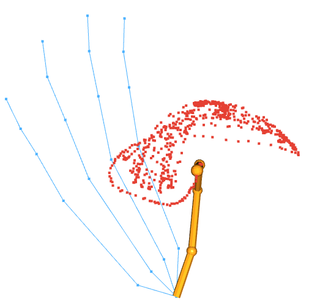
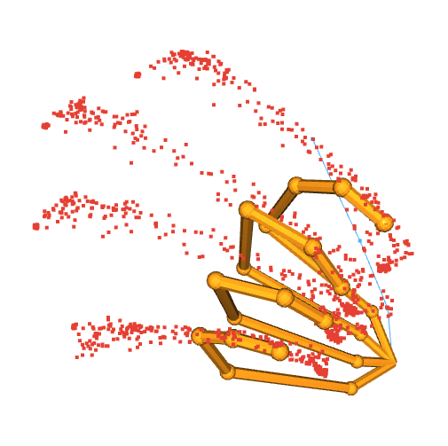
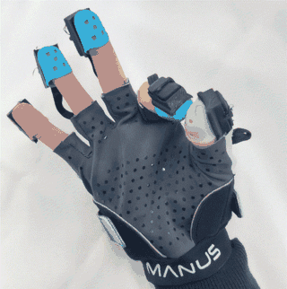

# Data Collection

Follow the [README setup instructions](../README.md#setup) first. Run all commands below from the repository root. Set `ROBOT_NAME` and `GLOVE_SERIAL` in `scripts/config.sh` before recording. Glove collectionrequires a display and a running MANUS SDK stream. Existing human recordings can be reused offline; a glove connection is needed only to record missing data.

## Collection stages

For retargeting, collect robot samples, glove motion and anchors in that order.
Contact recordings are additionally needed to train the optional contact
classifier; collect them after glove motion.

```bash
bash scripts/collect_robot.sh
bash scripts/collect_motion.sh
bash scripts/collect_anchors.sh
bash scripts/collect_contact.sh
```

Set `DATA_ROOT` and `GLOVE_HAND_TYPE` (`left` or `right`, default `right`) in `scripts/config.sh`. For direct Python invocations, use `--data-root` and `--hand-type`; every collection stage also requires `--config`.
For example:

```bash
python collect.py robot --config configs/sharpa.json --data-root data
```

Collection windows display the live glove skeleton and highlight the active fingers in orange. Recorded fingertip trajectories are shown in red.

## Robot data sampling

Set `ROBOT_NAME` and `DATA_ROOT` in `scripts/config.sh`, then run:

```bash
bash scripts/collect_robot.sh
```

This stage samples 10,000 joint configurations per finger within the configured joint limits and computes their fingertip poses using the URDF. It saves the joint–pose pairs and normalization statistics under `data/<robot>/generated_hand_pose/` (or your configured data root), and generates robot reference trajectories for the anchor tasks. No physical robot, glove or MANUS SDK connection is required.

Existing per-finger sample files are skipped; normalization statistics and robot anchor references are regenerated. If you change the URDF or joint limits, use a fresh robot data directory to avoid reusing outdated samples.

## Motion recordings

**Cover as much of each finger's motion workspace as possible.** Move through the full intended range of bending, extension and lateral motion, including combinations of these movements. Broad workspace coverage is important for good retargeting results; recording only a small range limits the motions the model can learn. Unless your application specifically requires backward bending (hyperextension), you can exclude those movements from the recordings.

<p align="center">
  
</p>

Motion collection records all five MANUS fingers, even for four-finger robots. For motion collection, press **r** to start each finger's 6,000-sample recording. Press **q** or close the window to cancel the collection run without saving the current partial recording. Completed finger files are preserved and skipped when you restart. The current motion finger is highlighted with thick orange bones and larger orange joints; the other fingers remain thin.

## Anchor recordings

<p align="center">
  
</p>

Anchor collection requires exactly **three recordings**, in this order:

1. **Four-finger bending:** repeatedly open the four non-thumb fingers and make a fist, keeping the thumb still. One full-skeleton recording supplies all non-thumb bending anchors (only mapped fingers are used by four-finger robots).
2. **Thumb bending:** repeatedly bend and extend the thumb, keeping the other fingers still.
3. **Thumb lateral rotation:** repeatedly rotate the thumb laterally through its comfortable range, keeping the other fingers still.

The visualization highlights all four non-thumb fingers for the fist task and only the thumb for the two thumb tasks.

**The starting pose determines the retargeting direction.** Start from the open/lower-limit end of each motion, as specified below. Starting from the opposite end reverses the anchor correspondence and can reverse the overall retargeting direction—for example, human finger bending may make the robot finger extend instead. Check the starting pose before pressing **r**.

For each recording, start at the open/lower-limit pose, press **r** to record, and press **q** after completing several repetitions to finish and save the anchor recording. Closing the window cancels without saving. Complete all three recordings before training.

## Contact recordings

**Maintain the target pinch contact throughout the entire recording.** Bring the thumb and the selected finger together at the intended contact location before pressing **r**, and keep that contact continuously until the episode finishes. Do not include approaching, releasing or separated-finger motions: all frames in the episode are treated as contact samples. If contact breaks, cancel the episode and record it again.

<p align="center">
  
</p>

Contact recordings pair the thumb with each other finger. Press **r** to start each 3,000-sample episode; press **q** or close the window to cancel without saving the current partial recording. Only complete episodes are saved, and existing recordings are skipped when you restart. The current contact pair is highlighted with thick orange bones and larger orange joints; the other fingers remain thin.

## Resuming and reusing recordings

Rerun a collection script to resume: completed recordings and robot samples are skipped. Human recordings are shared across robots in `data/global_data/`. To use another hand, change `ROBOT_NAME` and rerun the robot, motion and anchor stages with the same `DATA_ROOT`. These generate the new hand's robot samples, transformed motions, anchors and normalization statistics. When all human
recordings are present, no glove connection is needed.

Use a fresh data root for a new glove calibration or recording session. If you change a registered hand's URDF or joint limits, regenerate its robot samples in a fresh robot data directory before training.

## Data layout and conventions

- `data/<hand>/generated_hand_pose/finger*.npz`: `pose` is `[N,7]`, `joint` is `[N,J]`.
- `data/<hand>/glove_data/finger*.npz`: `finger_pose` is `[N,7]` in robot finger order.
- `data/<hand>/anchor/{hand_joint,hand_fingertip,glove_keypoint}/`: paired anchors.
- `data/<hand>/anchor/robot_trajectories/`: `fingers_bend.npz`, `thumb_bend.npz`
  and `thumb_lateral.npz`, containing isolated robot reference motions.
- `data/global_data/anchor/raw_glove/`: shared `fingers_bend.npy`, `thumb_bend.npy` and
  `thumb_lateral.npy`. These contain extracted/resampled full-skeleton glove
  trajectories before robot-frame transformation (100, 100 and 50 frames).
- `data/global_data/glove_data/`: five MANUS motion recordings and `norm_stats.json`.
- `data/global_data/contact_data/finger_0_*.npz`: `finger_pose`
  is `[N,5,7]` in MANUS order (thumb through pinky).

Pose vectors contain XYZ followed by a **wxyz** quaternion. Normalization scales XYZ isotropically per finger and preserves quaternion components.

Once collection is complete, continue with [model training](../README.md#model-training).
